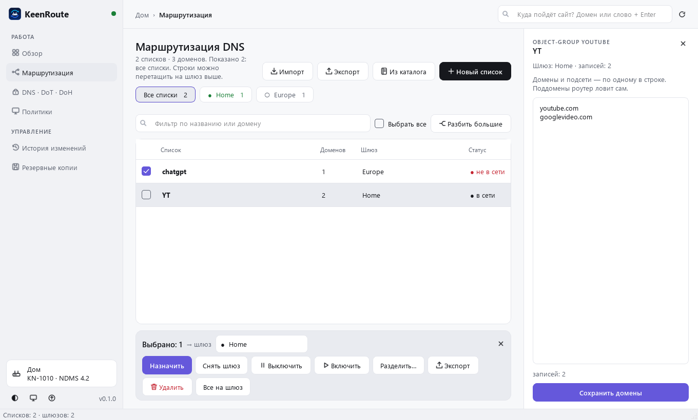
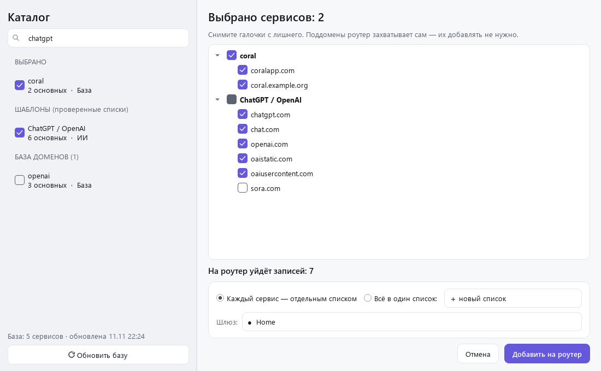
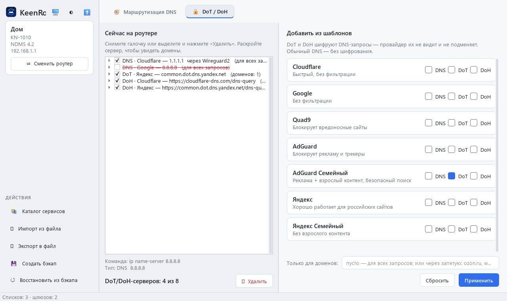
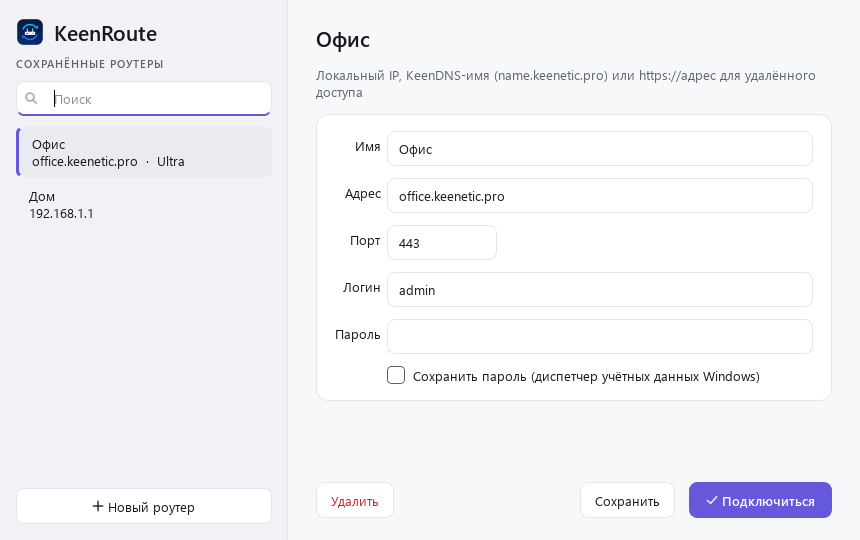
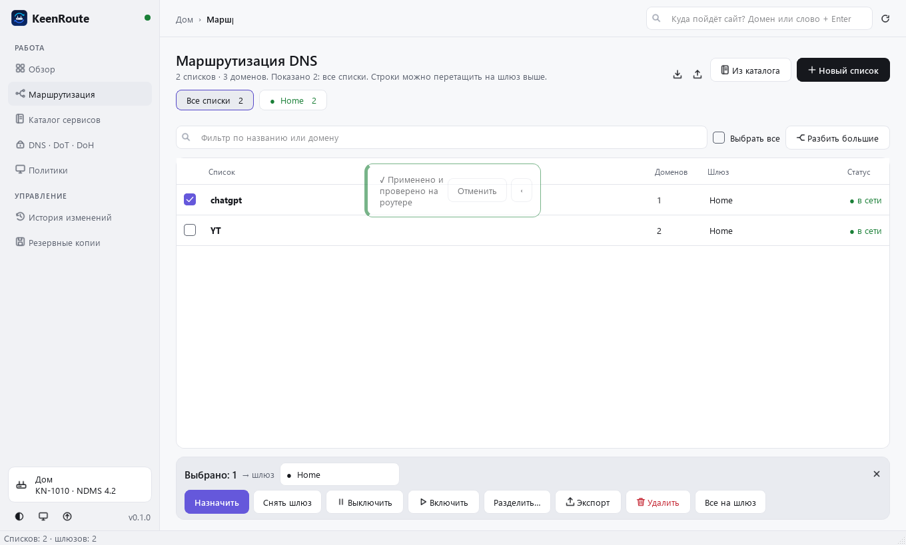

<p align="center"></p>

<h1 align="center">KeenRoute</h1>
<p align="center">Умные DNS-маршруты для роутеров Keenetic / Netcraze — программа для Windows 10/11</p>

<p align="center">
  <a href="https://github.com/mrbean13140-tech/KeenRoute/releases/latest/download/KeenRoute.exe"><b>⬇ Скачать KeenRoute.exe</b></a>
  &nbsp;·&nbsp; <a href="https://github.com/mrbean13140-tech/KeenRoute/releases">Все версии</a>
</p>

<p align="center"></p>

| Каталог сервисов | DNS / DoT / DoH |
|---|---|
|  |  |
| **Сохранённые роутеры** | **Светлая тема** |
|  |  |

Скачайте exe и запустите. При первом запуске KeenRoute предложит установиться в `%LOCALAPPDATA%\Programs\KeenRoute` и создаст ярлыки на рабочем столе и в меню «Пуск». Обновления ставятся туда же и программа перезапускается сама.

Программа для Windows: управление DNS-маршрутами (маршрутизация по спискам доменов) на роутерах Keenetic/Netcraze через встроенный REST API (RCI). SSH и Entware не нужны.

## Возможности
- Вход: IP (по умолчанию — шлюз сети), логин, пароль. Модель и версия NDMS определяются автоматически.
- Таблица списков `object-group fqdn`: число доменов, шлюз, статус подключения.
- Список подключений WireGuard и других шлюзов (PPTP/L2TP/OpenVPN/SSTP/IPsec/провайдер).
- Назначение шлюза выбранным спискам или «Перевести ВСЕ» на один WG.
- «Разделение…» — распределить списки по разным WG в одной таблице.
- Редактирование доменов, создание и удаление списков, разбиение больших списков на части.
- Импорт: JSON, TXT или по URL. При совпадении имён — объединить, заменить или переименовать.
- Экспорт: JSON (все или выбранные) или TXT (один список).
- Перед любым изменением — предпросмотр CLI-команд. Перед первой записью — бэкап running-config, есть откат из бэкапа.

## Каталог сервисов
- Шаблоны из проверенных списков: ChatGPT, Claude, Gemini, YouTube, Telegram, WhatsApp/Instagram, Discord, Netflix, TikTok, X, Spotify, «Россия».
- Поиск по локальной базе доменов (v2fly/domain-list-community, ~1550 сервисов): пишешь название или домен — получаешь готовый список с галочками.
- Ужатие: поддомены не добавляются (роутер захватывает их сам), региональные зеркала (youtube.de…) и IP — по желанию.
- IP-подсети компании через RIPEstat, если сервиса нет в базе.
- База обновляется только по кнопке «Проверить обновления базы»: программа покажет, какие новые домены добавятся в списки из каталога (снятые вручную не возвращаются).

## Запуск
Скачать `KeenRoute.exe` из Releases (или из артефактов GitHub Actions) и запустить.

Из исходников:
```
pip install -r requirements.txt
python run.py
python run.py --dump 192.168.1.1 admin PASSWORD   # отладка без GUI
```

## Файлы
`%APPDATA%\KeenRoute\` (данные прежней версии переносятся автоматически) — `backups\`, `logs\app.log`, `login.json` (без пароля; пароль хранится в диспетчере учётных данных Windows, если выбрано «Запомнить»).

## Требования к роутеру
NDMS 3.x/4.x с компонентом DNS-маршрутизации. Пользователь должен иметь доступ к веб-интерфейсу.

## Сборка
`pip install -r requirements-dev.txt && pyinstaller --onefile --windowed --name KeenRoute --icon assets/icon.ico --add-data "assets;assets" --paths src run.py`.
Это же делает CI; при теге `v*` создаётся Release с exe.
